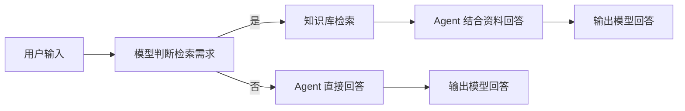

# 智能体接入工作流

## 为什么旧分支模板没有回答问题

检查实际保存的 `wor_11176e7d55ac4d43` 及输入「你是谁？」的运行记录后，确认流程只有输入、条件和两个文本输出节点，没有 Agent 节点。条件仅比较输入是否等于「查知识库」，输出仅渲染固定文案。因此运行成功仅表示文本路由执行成功，不代表模型回答了问题。该流程当前保存为 V3。

旧模板现明确标记为「规则分支 · 路由演示」，输出节点也提示它不会调用模型。默认新建流程改为智能体问答，需要选择已有 Agent。

## 编排方式

参考 BISHENG 的 [Agent 节点](https://github.com/dataelement/bisheng/blob/main/src/backend/bisheng/workflow/nodes/agent/agent.py)、[条件节点](https://github.com/dataelement/bisheng/blob/main/src/backend/bisheng/workflow/nodes/condition/condition.py) 和 [知识检索节点](https://github.com/dataelement/bisheng/blob/main/src/backend/bisheng/workflow/nodes/knowledge_retriever/knowledge_retriever.py)，将模型执行、条件控制、检索与输出作为独立可执行节点。Codezzn 复用自己的 Agent 执行器、模型提供方和知识库适配器。

「智能体问答」为输入 → Agent → 输出，不要求配置知识库。「智能分支问答」使用以下结构：



检索决策节点复用所选 Agent 的模型配置，使用专用分类提示词。只看用户问题、所选知识库的名称与描述、可编辑决策说明；不会提前检索，也不会调用工具。判断结果是 `{matched, reason, query}`，可在运行日志中查看。「是 / 否」端口分别按 matched 为 true / false 执行。知识库描述要写清具体业务范围；模型判断可能有误，固定业务规则仍可使用条件节点。

回答节点复用 Agent 的系统提示词和模型。`knowledge_mode: workflow` 禁用该次节点调用中 Agent 自身绑定的知识库检索，显式知识节点的结果通过 `{{knowledge_1}}` 传入。`tool_mode: disabled` 禁止该次调用中的内置、隐式项目 / 工作流、编码、MCP 等工具；需要执行工具时可选择 inherit。两项设置仅影响当前节点，不修改原 Agent 资源。

旧节点未设置这两项策略时继续继承原配置。新的智能问答模板默认由工作流控制检索、仅生成回答；需要 Agent 工具执行能力时在节点设置中启用继承。该版本为每次运行传入当前输入与上游变量，没有增加跨运行的对话历史。工具需要人工审批时明确报错，尚不支持工作流暂停后恢复审批，避免把空结果报告成成功。

节点日志记录 Agent 名称、实际模型 / 提供方、耗时、输出和检索诊断。模型分类 JSON 无效、Agent 返回空回答或未完成审批、知识库服务连接失败均明确报错。正常检索成功但无匹配片段时，Agent 会按提示说明缺少依据。

## 更新与修复已有流程

修改源代码后需再次部署。在项目根目录运行：

```powershell
cd D:\code-agent-rag-workflow
$env:CODEZZN_BUILD_TARGET = 'prebuilt'
docker compose --progress plain up -d --build codezzn
```

本次已生成新的 `web/workflow-editor/`。如果之后再次修改前端，先在 `frontend/workflow-editor` 执行 `npm.cmd run build`。若使用通常的 runtime 构建目标，Docker 会自行构建前端。

1. Ctrl+F5 刷新工作台，编辑已有「条件分支演示」。
2. 点击左侧提示中的「配置智能问答」，进入右侧「工作流设置」。
3. 点击「升级为智能分支问答」。仅原始演示图提供自动升级，定制流程可使用模板或逐节点编辑；应用后仍需保存，可撤销。
4. 在「统一选择智能体」选择 `Codezzn Assistant`，在「统一选择知识库」勾选目标知识库。每个节点也可以选择不同 Agent 或知识库范围。
5. 校验、保存为新版本，再测试。原版本历史继续保留。

也可在原流程导入 `outputs/workflow-canvas/intelligent-qa.json`，这份文件已填入当前账号的 Agent 和知识库 ID，保存即生成下一版本。其他账号应使用通用模板并重新选择资源。

输入「你是谁？」：检索决策应为 false；知识检索与结合资料回答节点跳过；直接回答 Agent 执行；最终输出模型的身份回答。输入明确涉及知识库内文档的问题：决策为 true；直接回答节点跳过；检索、结合资料回答执行。决策为 true 不保证知识库连接成功或能召回资料，需查看检索节点日志。

当前真实 Agent 实测记录见 `outputs/workflow-canvas/live-identity-test.json`。测试使用已有 Codezzn Assistant / qwen3.7-plus，身份问题成功直接回答。受控适配器测试验证了真假两条分支的数据流与检索调用。

现有外部 RAGFlow 配置指向 `192.168.33.17:9380`；此前在 Codezzn 容器内调用 health 与 retrieval 均返回 ConnectError。这只影响选用 RAGFlow 资源的检索分支；工作流不要求使用这个地址。源码不会把远端连接错误当作空召回继续生成回答。

## 使用本地知识库测试

1. 工作台 → 知识库 → 新建，后端类型选择「本地 Milvus」，名称例如「本地工作流测试」，描述写「Codezzn 测试环境的部署口令与运行说明」。
2. 配置支持 Embedding 的提供方、有效的模型名称和对应向量维度。上传 `samples/workflows/local-knowledge-test.txt`，确认上传成功及文档已有片段。本地索引不使用 RAGFlow 地址或 API Key；回答模型与 Embedding 仍取决于配置的模型提供方。
3. 返回画布，点击右侧底部「刷新资源」，在「工作流设置 → 统一选择知识库」取消原有 RAGFlow 勾选，只选择新建本地知识库。该操作同时更新检索决策范围和知识检索节点。
4. 确认回答 Agent 节点的知识检索策略为「由工作流控制」；保存新版本。
5. 测试「本地工作流测试环境的部署口令是什么？」：检索分支应召回文档，回答包含 `local-workflow-2026`。模型路由可能判断错误，此时查看决策理由，调整决策说明或用「知识库问答」模板直接验证检索。
6. 测试「你是谁？」：应走直接回答分支，知识节点跳过。节点日志可查看实际检索后端；本地向量 / 重排序不可用时，允许使用已有本地片段的关键词检索结果，并保留 `fallback` 诊断。

本地向量索引由现有 Docker 配置的 `/app/data/milvus.db`（宿主机 `data/milvus.db`）持久化。新上传需要 Embedding 服务正常和 Milvus 可用；关键词回退只适用于已经成功导入的片段。改变已有 RAGFlow 资源的后端不会自动迁移远端文档，应新建本地资源后重新上传。

## 测试停止运行

运行后点击测试面板标题右侧「停止运行」，按钮立即显示「正在停止…」。服务确认后运行状态为「已停止」，执行中的节点标为已停止，尚未执行的下游节点不会继续启动；节点日志保留停止前的结果。取消后迟到的模型响应、错误或状态轮询不能把运行改回进行中 / 已完成，也不会触发任务重试。

取消请求失败时会明确提示「停止失败」并恢复按钮；任务已经完成时会显示实际完成状态。关闭测试面板只隐藏面板，后台继续运行；需要停止请使用停止按钮。测试时选一个调用真实模型的工作流并在模型返回前点击停止，随后重新运行验证可以开始新任务。

## JSON 配置

通用示例：`samples/workflows/canvas-agent-chat.json` 与 `samples/workflows/canvas-smart-rag.json`。须补齐 Agent / 知识库 ID。

```json
{
  "id": "direct_agent",
  "type": "agent",
  "agent_id": "你的智能体ID",
  "prompt": "{{input}}",
  "knowledge_mode": "workflow",
  "tool_mode": "disabled"
}
```

```json
{
  "id": "router_1",
  "type": "router",
  "agent_id": "你的智能体ID",
  "knowledge_ids": ["你的知识库ID"],
  "query": "{{input}}",
  "prompt": "身份、问候直接回答；公司内部文档问题检索。"
}
```
